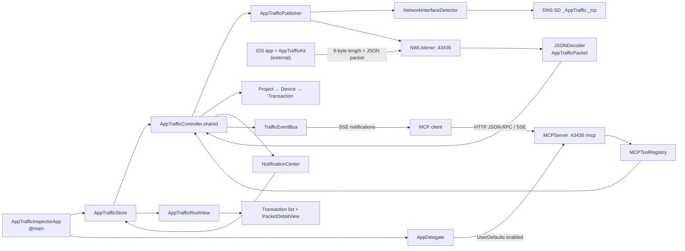
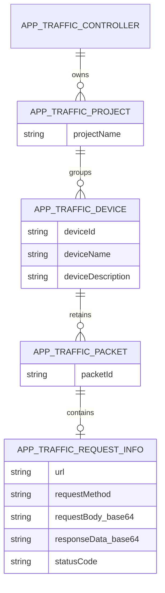
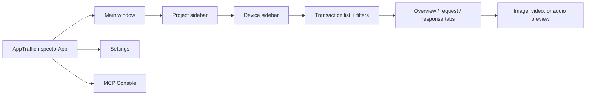

# App Traffic Inspector Code Atlas

> **Atlas version:** 1.1  
> **Derived:** 2026-09-17  
> **Source revision:** unavailable — this folder is not a Git worktree  
> **Scope:** the files present at the repository root on the derived date

This atlas describes the repository as found. Paths are repository-relative. Line citations point
to the source snapshot above. Statements marked **inferred** describe behavior implied by code or UI
copy rather than an explicit product specification.

## 1. At a Glance

| Fact | Derived value | Evidence or derivation command |
|---|---|---|
| Product | Native macOS network-traffic viewer for traffic reported by iOS apps | `README.md:1-8` |
| Primary language | Swift 6.0 | `grep -n 'SWIFT_VERSION' AppTrafficInspector.xcodeproj/project.pbxproj` → `6.0` at `AppTrafficInspector.xcodeproj/project.pbxproj:425,438,612,662` |
| Other executable language | Bash | `find . -type f` → `Scripts/run_acceptance_tests.sh` |
| App target Swift files | 46 | `find . -type f -name '*.swift' -not -path './.build/*' -not -path './AppTrafficInspectorTests/*' -not -path './AppTrafficInspectorUITests/*' -not -path './Scripts/*' -not -path './SwiftUI/*' -not -path './Base/*' \| wc -l` |
| App target Swift LOC | 4,603 | Same app-target `find` expression with `-print0 \| xargs -0 wc -l \| tail -1` |
| Unit-test Swift LOC | 258 | `find AppTrafficInspectorTests -type f -name '*.swift' -print0 \| xargs -0 wc -l` |
| UI-test Swift LOC | 77 | `find AppTrafficInspectorUITests -type f -name '*.swift' -print0 \| xargs -0 wc -l` |
| All Swift LOC, including tests and non-target support | 5,275 | `find . -type f -name '*.swift' -not -path './.build/*' -print0 \| xargs -0 wc -l \| tail -1` |
| Native targets | 3: app, unit tests, and UI tests | `xcodebuild -project AppTrafficInspector.xcodeproj -list -json`; target declarations at `AppTrafficInspector.xcodeproj/project.pbxproj:321-374` |
| Build configurations | Debug, Release | `xcodebuild -project AppTrafficInspector.xcodeproj -list -json` |
| Schemes | `AppTrafficInspector` | `xcodebuild -project AppTrafficInspector.xcodeproj -list -json` |
| External package dependencies | 0 | `grep -c 'XCRemoteSwiftPackageReference' AppTrafficInspector.xcodeproj/project.pbxproj` → `0`; framework phases are empty at `AppTrafficInspector.xcodeproj/project.pbxproj:114-129` |
| System link dependency | `libsystem_dnssd` | `AppTrafficInspector.xcodeproj/project.pbxproj:608,658` |
| Unit tests | 19 Swift Testing cases | `grep -Rh '@Test' AppTrafficInspectorTests --include='*.swift' \| wc -l` → `19` |
| UI journeys | 1 XCTest journey | `find AppTrafficInspectorUITests/Journeys -name '*.swift' -exec grep -h 'func test' {} + \| wc -l` → `1` |
| Acceptance checks | 14 possible pass assertions | `grep -c 'passed += 1' Scripts/mcp_acceptance_test.swift` → `14` |
| Production MCP tools | 14 | Count registrations outside `#if DEBUG` in `MCP/MCPServer.swift:48-70` |
| Debug MCP tools | 17 | `awk '/private func registerTools\\(\\)/,/^    }/' MCP/MCPServer.swift \| grep -c 'toolRegistry.register'` → `17` |
| App entry point | `AppTrafficInspectorApp` | `AppTrafficInspectorApp.swift:4-22` |
| Lifecycle delegate | `AppDelegate` | `AppDelegate.swift:10-67` |
| Traffic entry point | TCP listener on port 43435 | `Network/AppTrafficConfiguration.swift:10-17`; `Network/AppTrafficPublisher.swift:47-113` |
| MCP entry point | HTTP/1.1 JSON-RPC/SSE server at `/mcp`, port 43436 | `MCP/MCPServer.swift:9-12,72-107,183-257` |
| Effective deployment target | macOS 26.0 for app and tests | `AppTrafficInspector.xcodeproj/project.pbxproj:422,435,498,557,606,656` |
| Documented deployment target | macOS 26.0 | `README.md` “System Requirements” |
| App version metadata | 1.0.1 / build 101 | `Info.plist:21-24`; `MARKETING_VERSION = 1.0.1` in `AppTrafficInspector.xcodeproj/project.pbxproj:745,795` |

**Repository shape.** There is one Xcode project, no Swift package manifest, no dependency manager
lockfile, no CI directory, and no Git metadata in this folder. The app uses Apple frameworks
(`SwiftUI`, `AppKit`/`Cocoa`, `Network`, `Foundation`, `SystemConfiguration`, `Darwin`, `os`) and the
system DNS-SD library.

## 2. Architectural Overview

### Domain

App Traffic Inspector receives serialized request/response observations from an external iOS
instrumentation library, groups them by project and device, and lets a developer inspect and filter
them. An optional Model Context Protocol (MCP) endpoint exposes the same in-memory traffic to AI
clients (`README.md:3-11,21-28`).

### Actual pattern

The app is a **transitional singleton MVC-to-SwiftUI observable-store architecture**, not a strict
single pattern:

| Layer | Current mechanism | Deviation or seam |
|---|---|---|
| Composition | SwiftUI `App` creates one `AppTrafficStore`; `AppDelegate` owns optional MCP server | `AppTrafficController` remains a lazy global singleton, outside explicit DI |
| Ingest | `AppTrafficPublisher` delegate calls `AppTrafficController` | Delegate callback crosses from `NWConnection` work to `MainActor` |
| Domain state | Mutable `NSObject` graph: controller → projects → devices → packets | No repository abstraction or durable persistence |
| UI state | `AppTrafficStore: ObservableObject` mirrors singleton state | Synchronization uses five `NotificationCenter` names, not direct observation |
| UI | SwiftUI navigation split view and sheets/windows | `JSONTextView` bridges to AppKit; model files still import Cocoa |
| Automation | Separate MCP listener and tool registry | Tools read the same singleton directly rather than through `AppTrafficStore` |

The migration direction is from the older mutable controller/model stack toward SwiftUI. The seam is
`AppTrafficStore.subscribeNotifications()` (`Models and Data Store/AppTrafficStore.swift:48-66`):
the store receives legacy notifications and republishes snapshots through `@Published` properties.
The unused duplicate `AppTrafficProject` under
`SwiftUI/Workers/AppTrafficController/Controllers/AppTrafficProjectController.swift:8-47` references
an absent `AppTrafficDeviceController` and is not listed in the Xcode project. It is evidence of an
abandoned or incomplete intermediate architecture, not live app code.



*This diagram answers: how does launch lead to the primary task of receiving and inspecting an
HTTP transaction, and where does MCP join that flow?*

### Layer map

| Layer | Paths | Responsibilities |
|---|---|---|
| App/lifecycle | `AppTrafficInspectorApp.swift`, `AppDelegate.swift`, `AppTrafficMenuCommands.swift` | Scene construction, lifecycle, commands, MCP start/stop |
| Presentation | `Views/`, `Base/Views/` | Navigation, filtering controls, detail rendering, settings, MCP console |
| Observable adapter | `Models and Data Store/AppTrafficStore.swift` | Bridges singleton notifications to SwiftUI bindings |
| Domain model | `Models and Data Store/*.swift` | Packet wire model and project/device aggregation |
| Coordination | `AppTrafficController.swift` | Owns traffic graph, selection, ingest classification, events |
| Traffic transport | `Network/` | Interface choice, TCP listener, length framing, JSON decode, Bonjour |
| MCP transport/application | `MCP/` | HTTP parser, JSON-RPC dispatch, tools, sessions, SSE, redaction |
| Utilities | `Utilities and Extensions/` | Formatting, highlighting, logging, small extensions |
| Verification | `AppTrafficInspectorTests/`, `Scripts/` | Redaction unit tests and live MCP acceptance script |

## 3. Build, Targets & Environments

### Targets and configurations

| Target | Type | Sources/resources | Debug vs Release |
|---|---|---|---|
| `App Traffic Inspector` | macOS application | 46 Swift source files in the PBX sources phase; `Assets.xcassets`; `Info.plist`; entitlements | Debug defines `DEBUG`; Release is optimized |
| `AppTrafficInspectorTests` | Unit-test bundle hosted by the app | `TrafficRedactorTests.swift` only | Both configurations use Swift 6.0, macOS 26.0, bundle ID `nz.ging.AppTrafficInspectorTests` (`AppTrafficInspector.xcodeproj/project.pbxproj:417-441`) |
| `AppTrafficInspectorUITests` | UI-test runner | Screen object, environment launcher, and media journey | macOS 26.0, bundle ID `nz.ging.AppTrafficInspectorUITests`; target at `AppTrafficInspector.xcodeproj/project.pbxproj:357-372` |

Both app configurations use bundle ID `nz.ging.AppTrafficInspector`, the same plist and empty
entitlements file, automatic signing with an empty team, app sandbox, hardened runtime, incoming and
outgoing networking, and read-only user-selected files (`AppTrafficInspector.xcodeproj/project.pbxproj:566-665`;
`AppTrafficInspector.entitlements:1-5`). The target links DNS-SD using `-lsystem_dnssd`; there are no
embedded third-party frameworks.

Debug adds three mutating MCP tools—`restart_listener`, `clear_packets`, and `inject_test_packet`—
through `#if DEBUG` (`MCP/MCPServer.swift:67-71`; `MCP/Tools/ControlTools.swift:10-68`). `DevLogger`
also stores logs only in Debug; its Release functions are no-ops
(`Utilities and Extensions/DevLogger.swift:11-56`).

### Runtime environments

There is no dev/staging/prod backend environment system. The only variants are compile-time Debug
and Release. Host/port constants are compiled into the app:

| Service | Debug | Release | Selection |
|---|---|---|---|
| App traffic ingest | `0.0.0.0`-style all-interface `NWListener`, TCP 43435, Bonjour `_AppTraffic._tcp` | Same | No runtime selector; constants in `Network/AppTrafficConfiguration.swift:10-17` |
| MCP | Loopback-only `NWListener` TCP 43436, HTTP path `/mcp` | Same | Bound to `127.0.0.1` at `MCP/MCPServer.swift:80`; enabled by `mcpServerEnabled`; Debug exposes three extra tools |

### Local commands

```bash
# Open and run interactively
open AppTrafficInspector.xcodeproj

# Build
xcodebuild -project AppTrafficInspector.xcodeproj \
  -scheme AppTrafficInspector \
  -configuration Debug \
  -destination 'platform=macOS' build

# Unit tests
xcodebuild -project AppTrafficInspector.xcodeproj \
  -scheme AppTrafficInspector \
  -destination 'platform=macOS' CODE_SIGNING_ALLOWED=NO \
  -only-testing:AppTrafficInspectorTests test

# Deterministic UI journey (requires macOS Automation permission)
xcodebuild -project AppTrafficInspector.xcodeproj \
  -scheme AppTrafficInspector \
  -destination 'platform=macOS' \
  -only-testing:AppTrafficInspectorUITests/MediaTransactionJourneyTests test

# Build, launch, exercise MCP, and quit
./Scripts/run_acceptance_tests.sh

# Lint, if SwiftLint is installed
swiftlint lint --config .swiftlint.yml
```

The acceptance wrapper itself uses the scheme name, builds Debug, sets the app preference, launches
the built product, waits for MCP, runs the Swift script, and quits the app
(`Scripts/run_acceptance_tests.sh:7-74`).

**Build metadata:** README, target settings, and `Info.plist` now agree on macOS 26.0 and version
1.0.1; `Info.plist` remains the explicit build-number source (`Info.plist:21-24`). The shared scheme
references the concrete `AppTrafficInspectorUITests` target.

## 4. Configuration, Feature Flags & Secrets

### Configuration surface and resolution order

| Setting | Kind/default | Read/write sites | Resolution |
|---|---|---|---|
| `mcpServerEnabled` | Runtime Boolean, default `false` | `Views/SettingsView.swift:8-18`; `AppDelegate.swift:8,32-34` | `UserDefaults`/`@AppStorage`; app launch reads it, UI changes post start/stop notifications |
| `mcpRedactionMode` | Runtime enum, default `strict` | `MCP/TrafficRedactor.swift:33-43`; `Views/SettingsView.swift:11,47-59` | Stored raw value → valid enum; absent/invalid falls back to `strict` |
| `mcpCustomRedactionFields` | Runtime string array, default empty | `MCP/TrafficRedactor.swift:34,45-51` | `UserDefaults`; no current UI editor |
| `hasSeenQuickStart` | Runtime Boolean, default `false` | `Views/AppTrafficRootView.swift:13,18-20,52-59` | `@AppStorage` |
| `quickStartGuideVersion` | Runtime integer, default `0` | `Views/AppTrafficRootView.swift:14,18-20,52-59` | Compared with compiled guide version |
| `QuickStartContent.currentGuideVersion` | Compile-time integer `1` | `Views/QuickStartView.swift:9` | Source constant |
| AppTrafficKit docs URL | Compile-time optional, currently `nil` | `Views/QuickStartView.swift:12,82-91` | `nil` renders “not set yet” copy |
| Traffic port/service | Compile-time constants | `Network/AppTrafficConfiguration.swift:10-17` | No override |
| MCP port/path | Compile-time constants | `MCP/MCPServer.swift:10-11` | No override |
| Debug capabilities | Compile-time `DEBUG` | `MCP/MCPServer.swift:67-71`; `Utilities and Extensions/DevLogger.swift:11-56` | Xcode `SWIFT_ACTIVE_COMPILATION_CONDITIONS = DEBUG` |

There is no layered config loader, environment-variable lookup, `.xcconfig`, remote flag service, or
runtime base-URL selection. Resolution is therefore: compiled constant or build condition, then
`UserDefaults` only where listed.

### Secrets

No required secret or variable names were found. There are no API keys, auth client IDs, signing
secrets, generated secret files, CI variable references, `.env` files, or Keychain calls. The app
target has an empty development team and an empty entitlements plist
(`AppTrafficInspector.xcodeproj/project.pbxproj:576,626`; `AppTrafficInspector.entitlements:1-5`).

`.gitignore` excludes `.DS_Store`, workspace-local build data, DerivedData, `*.xcuserstate`, and
`xcuserdata/`. Missing runtime preferences use the defaults in the table; missing network interfaces
cause the traffic listener to log and retry after one second
(`Network/AppTrafficPublisher.swift:49-53,205-209`).

## 5. Security & Identity Architecture

### Identity and authentication

No identity provider, login flow, OAuth/OIDC grant, token lifetime, refresh strategy, user account,
authorization policy, Keychain storage, or client authentication exists in this repository. The
traffic listener trusts any peer that can connect to port 43435. The MCP server creates UUID session
IDs on `initialize`, accepts a supplied ID for deletion, but does not require or validate sessions
before other calls (`MCP/MCPServer.swift:14-18,221-245`).

### Transport and data exposure

| Boundary | Protection present | Missing or constrained behavior |
|---|---|---|
| iOS producer → traffic listener | 8-byte framed payload; transaction capped at 25 MiB (`Network/AppTrafficConfiguration.swift:18`; `Network/AppTrafficPublisher.swift:204`) | Plain TCP, no TLS, mTLS, pinning, authentication, or payload signature |
| Bonjour advertisement | Restricted to the selected interface through DNS-SD (`Network/BonjourSingleInterfaceRegistrar.swift:62-119`) | Service advertises ingest availability on the LAN |
| MCP client → MCP server | Explicit `127.0.0.1` bind; exact loopback Origin validation; 64 KiB headers and 2 MiB bodies; consistent export redaction (`MCP/MCPServer.swift:80,203-220`; `MCP/MCPHTTPParser.swift:17-18,30-35,64-72`; `MCP/Tools/TrafficTools.swift:113-115,144-150,198-200,246-254`) | Plain HTTP; no auth; absent Origin accepted; `OPTIONS` returns wildcard CORS |
| App sandbox | Sandbox and hardened runtime enabled in build settings (`AppTrafficInspector.xcodeproj/project.pbxproj:577-580,627-630`) | Entitlements file is empty; effective capabilities come from build settings |
| Exported transaction data | Strict redaction is default and is applied to detail, search URLs, and cURL output (`MCP/TrafficRedactor.swift:144-177`; `MCP/Tools/TrafficTools.swift:113-115,144-150,198-200,246-254`) | `moderate` redacts headers only; `off` intentionally exposes raw data |

No ATS exception is declared. `Info.plist` contains `ATSApplicationFontsPath`, not
`NSAppTransportSecurity` (`Info.plist:4-6`). ATS does not provide TLS for the inbound Network
framework listeners.

### Security-sensitive hotspot register

| Priority | Hotspot | Why it is sensitive | Evidence |
|---|---|---|---|
| High | Unauthenticated ingest | Arbitrary reachable clients can submit packet-shaped JSON to port 43435 | `Network/AppTrafficPublisher.swift:64-72,104-109,144-195` |
| Medium | Optional Origin | Exact loopback Origins are enforced when supplied, but clients without an Origin header are accepted | `MCP/MCPServer.swift:203-220` |
| Medium | In-memory sensitive payloads | Full request/response headers and base64 bodies remain in mutable memory until evicted, cleared, or exit | `Models and Data Store/AppTrafficRequestInfo.swift:31-42`; retention limits at `Models and Data Store/AppTrafficDevice.swift:9-10,61-76` |
| Low | Logs | MCP session IDs and request summaries enter an in-memory UI-visible log in Debug | `MCP/MCPServer.swift:230-233`; `MCP/MCPActivityLog.swift:34-43` |

## 6. Networking / IO Layer

### Host map

| Service | Development | Test | Staging | Production |
|---|---|---|---|---|
| Traffic ingest | Local Mac, all interfaces, TCP `43435`; Bonjour `_AppTraffic._tcp` | Same executable; synthetic packet can bypass socket in Debug | Not defined | Same compiled endpoint |
| MCP | Bound URL `http://127.0.0.1:43436/mcp` | Acceptance script uses the same URL | Not defined | Same loopback endpoint, with Debug-only tools omitted |
| External backend | None | None | None | None |

### Traffic packet pipeline

1. `NetworkInterfaceDetector` enumerates `ifaddrs`, drops loopback/link-local and named virtual
   interfaces, and prefers Ethernet, then Wi-Fi (`Network/NetworkInterfaceDetector.swift:34-106`).
2. `AppTrafficPublisher` opens an `NWListener` with `NWParameters.tcp` on port 43435 and advertises
   it with `BonjourSingleInterfaceRegistrar` only after the listener is ready
   (`Network/AppTrafficPublisher.swift:47-113`).
3. Each connection reads exactly eight bytes. Big-endian length is preferred, with legacy
   little-endian fallback; lengths above 25 MiB cancel the connection
   (`Network/AppTrafficConfiguration.swift:18`; `Network/AppTrafficPublisher.swift:204`).
4. The exact body length is read and decoded with `JSONDecoder`, using Unix seconds for dates
   (`Network/AppTrafficPublisher.swift:178-195,211-227`).
5. Decode success is dispatched to the main actor delegate. Decode failure is printed and dropped;
   there is no protocol error response (`Network/AppTrafficPublisher.swift:211-227`).
6. Listener failure retries after one second. Individual connection failure removes that connection
   but does not restart the listener (`Network/AppTrafficPublisher.swift:91-95,198-209`).

There is no application-level retry, request/response exchange, compression, backpressure, durable
queue, or network reachability observer for producer traffic.

### MCP pipeline

`MCPServer` accepts HTTP/1.1 bytes and passes a mutable buffer to `MCPHTTPParser`. The parser caps
headers at 64 KiB and request bodies at 2 MiB, rejects negative/invalid `Content-Length`, and does
not implement chunked transfer encoding (`MCP/MCPHTTPParser.swift:17-18,27-35,64-79`). `/mcp`
supports:

| Method | Behavior |
|---|---|
| `POST` | JSON-RPC `initialize`, `notifications/initialized`, `tools/list`, `tools/call`, `ping` |
| `GET` | Opens an SSE stream of traffic notifications |
| `DELETE` | Removes a supplied session ID |
| `OPTIONS` | Returns permissive CORS method headers |

JSON-RPC errors map to standard `-32600` through `-32603` codes
(`MCP/MCPJSONRPCHandler.swift:15-68`). Transport statuses include 200, 202, 400, 403, 404, 405,
and 413.
No automatic retry exists on the server side.

## 7. Class & Component Catalog

### Composition and state

| Symbol | Responsibility | Key collaborators / pattern role | Path |
|---|---|---|---|
| `AppTrafficInspectorApp` | Creates scenes and root store | Composition root; `AppDelegate`, root/settings/console views | `AppTrafficInspectorApp.swift:4-22` |
| `AppDelegate` | App lifecycle and optional MCP lifetime | Adapter around `NSApplicationDelegate`; `MCPServer`, notifications | `AppDelegate.swift:10-67` |
| `AppTrafficController` | Owns canonical in-memory graph and selection | Singleton coordinator; publisher delegate; event producer | `AppTrafficController.swift:25-107` |
| `AppTrafficStore` | Publishes snapshots for SwiftUI | Observable adapter over controller and notifications | `Models and Data Store/AppTrafficStore.swift:5-126` |

The composition root explicitly wires only the store and views. `AppTrafficController.shared`,
`MCPServerStatus.shared`, `MCPActivityLog.shared`, and `TrafficEventBus.shared` are service-locator
style globals created at first access.

### Domain and transport

| Symbol | Responsibility | Key collaborators / pattern role | Path |
|---|---|---|---|
| `AppTrafficPacket` | Codable wire aggregate and identity-based hashability | Owns request info plus nested project/device DTOs | `Models and Data Store/AppTrafficPacket.swift:8-30` |
| `AppTrafficRequestInfo` | Codable HTTP observation | Custom status-code decoder accepts number or legacy string | `Models and Data Store/AppTrafficRequestInfo.swift:29-82` |
| `AppTrafficProject` | Groups devices by ID, then project/name fallback | Mutable domain node | `Models and Data Store/AppTrafficProject.swift:8-52` |
| `AppTrafficDevice` | Deduplicates transactions, owns selection, and evicts oldest data beyond 1,000 transactions or 250 MiB | Mutable domain node | `Models and Data Store/AppTrafficDevice.swift:8-76` |
| `RequestMethod` | Six supported HTTP verbs and display colors | Wire enum/UI concern | `Models and Data Store/AppTrafficRequestInfo.swift:9-27` |
| `AppTrafficPublisher` | TCP lifecycle, framing, decoding | Inbound adapter, delegate source | `Network/AppTrafficPublisher.swift:14-228` |
| `NetworkInterfaceDetector` | Enumerates and ranks host interfaces | Infrastructure helper | `Network/NetworkInterfaceDetector.swift:32-137` |
| `BonjourSingleInterfaceRegistrar` | Publishes DNS-SD on one interface | C API adapter | `Network/BonjourSingleInterfaceRegistrar.swift:54-132` |
| `AppTrafficConfiguration` | Ingest DNS-SD constants | Static configuration holder | `Network/AppTrafficConfiguration.swift:8-18` |

### MCP

| Symbol | Responsibility | Key collaborators / pattern role | Path |
|---|---|---|---|
| `MCPServer` | Listener, HTTP routing, sessions, SSE connections | Transport/application controller | `MCP/MCPServer.swift:43-321` |
| `MCPHTTPParser` | Minimal HTTP request parser/response encoder | Protocol adapter | `MCP/MCPHTTPParser.swift:17-117` |
| `MCPJSONRPCHandler` | JSON-RPC method dispatch/error mapping | Application dispatcher | `MCP/MCPJSONRPCHandler.swift:10-113` |
| `MCPTool` | Tool contract | Command pattern | `MCP/MCPToolRegistry.swift:18-23` |
| `MCPToolRegistry` | Tool registration and name lookup | Command registry | `MCP/MCPToolRegistry.swift:25-48` |
| `TrafficEventBus` | Main-actor fan-out to `AsyncStream` subscribers | In-process event bus | `MCP/TrafficEventBus.swift:65-96` |
| `TrafficRedactor` | MCP privacy transformations | Policy utility backed by `UserDefaults` | `MCP/TrafficRedactor.swift:14-177` |
| `MCPActivityLog` | 500-entry MCP activity ring | Observable singleton for console | `MCP/MCPActivityLog.swift:19-48` |
| `MCPServerStatus` | Running/request/subscriber status | Observable singleton for settings | `MCP/MCPServerStatus.swift:11-18` |
| Traffic tools | List/search/detail/cURL over canonical graph | Read commands | `MCP/Tools/TrafficTools.swift` |
| Connection tools | Listener/interface/connection/log diagnostics | Read commands | `MCP/Tools/ConnectionTools.swift` |
| Diagnostic tools | App info, privacy settings, incoming summary | Read/write commands | `MCP/Tools/DiagnosticTools.swift` |
| Control tools | Restart, clear, inject | Debug-only commands | `MCP/Tools/ControlTools.swift` |

### Presentation

| Symbol | Responsibility | Collaborators | Path |
|---|---|---|---|
| `AppTrafficRootView` | Native macOS project/device/transaction navigation, filters, and capture health | `AppTrafficStore`, `PacketDetailView`, `CaptureStatusPill` | `Views/AppTrafficRootView.swift` |
| `GlassPanel` / `CaptureStatusPill` / `MethodBadge` | Discrete macOS 26 toolbar pill, semantic method badge, and reusable panel | SwiftUI `.glassEffect` | `Views/GlassComponents.swift` |
| `PacketDetailView` | Six-tab transaction details with native segmented picker; opens response body for media | `PacketFormatting`, async body/overview views | `Views/PacketDetailView.swift` |
| `BodyViewAsync` | Bounded base64/JSON/media rendering with image zoom and AVKit playback | `BodyDisplayResult`, `MediaPayload`, `JSONTextView` | `Views/BodyViewAsync.swift:11-287` |
| `OverviewContentAsync` | Off-main overview construction | Packet/request values, `JSONTextView` | `Views/OverviewContentAsync.swift:13-85` |
| `JSONTextView` | Selectable attributed JSON text | AppKit bridge | `Views/JSONTextView.swift:11-49` |
| `SettingsView` | MCP enablement, status, privacy mode | AppStorage and server status singleton | `Views/SettingsView.swift:8-72` |
| `MCPConsoleView` | Filterable activity log window | Activity-log singleton | `Views/MCPConsoleView.swift:10-128` |
| `QuickStartView` | First-run setup guide | AppTraffic configuration | `Views/QuickStartView.swift:8-106` |

## 8. Data Model & View Hierarchies

The app has no durable database. Its schema is an in-memory mutable object graph; request and
response bodies remain base64 strings in `AppTrafficRequestInfo`.



*This diagram answers: which in-memory entities own each captured HTTP transaction and payload?*



*This diagram answers: where does a user navigate to reach transaction details and media previews?*

UI definitions are SwiftUI source under `Views/`; `JSONTextView` is the only AppKit representable.
There are no storyboards or nibs. `AppTrafficRootView` preserves the project → device → transaction
hierarchy inside `NavigationSplitView` (`Views/AppTrafficRootView.swift:36-53`). The presentation
layer conforms to Apple's Human Interface Guidelines: split-view sidebars adopt full-height system
vibrancy, content controls use standard macOS rounded-border search and segmented pickers, and
translucent materials are reserved for floating contextual HUD overlays (`BodyViewAsync.swift`)
and toolbar status indicators (`CaptureStatusPill`).

### State management and concurrency

| Concern | Implementation | Constraint |
|---|---|---|
| Canonical app state | `@MainActor AppTrafficController.shared` mutable arrays | Process-local only; no persistence |
| SwiftUI projection | `@MainActor AppTrafficStore` with `@Published` snapshots | Arrays can become stale unless one of five notifications fires |
| Selection | Mutable references on controller/project/device | Selection changes post notifications in `didSet`/methods |
| Network callbacks | Network framework global queues, then main-queue dispatch | `AppTrafficPublisher` is `@unchecked Sendable` |
| MCP tools | `async` commands wrap controller access in `MainActor.run` | Registry dictionary is `nonisolated(unsafe)` after startup |
| MCP sessions | Private actor holding `Set<String>` | IDs are stored/deleted but not enforced |
| SSE subscribers | Main-actor singleton plus `AsyncStream` | Disconnect closure bridges back to main actor |
| Body rendering | Detached tasks receive value copies | Avoids processing larger bodies on the UI actor |
| Logs | `NSLock`-protected static ring in Debug | Empty in Release |

Important unsafe-concurrency declarations are concentrated in
`Network/AppTrafficPublisher.swift:14`, `MCP/MCPServer.swift:43`,
`MCP/MCPToolRegistry.swift:25-27`, and `Utilities and Extensions/DevLogger.swift:14-16`.

## 9. User Roles, Stories & Flows

No account roles are implemented. The roles below are product roles inferred from UI and protocol
surfaces.

| Role/story | Flow | Key implementation | Enforced rules |
|---|---|---|---|
| **iOS developer — inspect traffic** (**inferred**) | Launch app → producer discovers Bonjour → sends framed JSON → select project/device/transaction → inspect tabs | `Network/AppTrafficPublisher.swift`; `AppTrafficController.swift`; `Views/AppTrafficRootView.swift`; `Views/PacketDetailView.swift` | Transaction ≤ 25 MiB (`Network/AppTrafficConfiguration.swift:18`); each device retains at most 1,000 transactions and 250 MiB (`Models and Data Store/AppTrafficDevice.swift:9-10,61-76`); packet ID updates the existing record |
| **iOS developer — narrow traffic** (**inferred**) | Enter URL/status/method terms → store recomputes packet list | `Views/AppTrafficRootView.swift:111-136`; `Models and Data Store/AppTrafficStore.swift:99-125` | Address/status use case-sensitive substring; method is case-insensitive; whitespace-only status matches empty statuses |
| **iOS developer — inspect payload** (**inferred**) | Select detail tab → decode base64 off-main → pretty-print text/JSON or preview image/video/audio | `Views/PacketDetailView.swift`; `Views/BodyViewAsync.swift` | Decoded media is capped at 25 MiB (`Views/BodyViewAsync.swift:78-90`); image/video/audio MIME types take precedence, with PNG/JPEG/GIF/MP4 signature fallback |
| **iOS developer — copy/replay** (**inferred**) | Copy selected tab or generate cURL | `Views/PacketDetailView.swift`; `Utilities and Extensions/PacketFormatting.swift` | URL, headers, and body are POSIX shell-quoted; cookies are omitted; GET and HEAD do not add `-X`; HEAD adds `--head` |
| **First-time user — onboarding** (**inferred**) | Launch → versioned Quick Start sheet → continue stores completion | `Views/AppTrafficRootView.swift:13-20,45-65`; `Views/QuickStartView.swift` | Guide reappears when compiled guide version exceeds saved version |
| **AI-tool user — query traffic** (**inferred**) | Enable MCP → initialize → list/call tools → optionally subscribe to SSE | `Views/SettingsView.swift`; `AppDelegate.swift`; `MCP/MCPServer.swift`; `MCP/Tools/TrafficTools.swift` | Detail output uses selected privacy mode; Debug adds mutation tools |
| **AI-tool user — change privacy** (**inferred**) | Call `set_redaction_mode` or use Settings picker | `MCP/Tools/DiagnosticTools.swift:41-73`; `Views/SettingsView.swift:47-59` | Only `strict`, `moderate`, `off`; invalid MCP input returns `isError` |
| **Developer — validate MCP** | Run shell wrapper → app starts with MCP preference → 14 possible assertions → teardown | `Scripts/run_acceptance_tests.sh`; `Scripts/mcp_acceptance_test.swift` | Includes deceptive-Origin rejection; script exits nonzero when any check fails |

## 10. External Integrations Map

| External system | Direction and interface | Auth | Standard path or bypass |
|---|---|---|---|
| AppTrafficKit in an iOS app | Sends length-prefixed packet JSON to TCP 43435 after Bonjour discovery | None in this repo | Standard ingest path; producer library is not present and README says “coming soon” (`README.md:17-18`) |
| Bonjour / DNS-SD | App publishes `_AppTraffic._tcp` through C `dns_sd` calls | Local-network service discovery | Bypasses `NWListener.service` deliberately; custom registrar calls `DNSServiceRegister` (`Network/BonjourSingleInterfaceRegistrar.swift:20-51,62-119`) |
| Cursor | MCP client over Streamable HTTP | None | Standard MCP path documented at `README.md:30-53` |
| Claude Code/Desktop | MCP client over Streamable HTTP or external bridge | None | Standard MCP path; bridge is outside this repo (`README.md:55-90`) |
| Other MCP clients | POST JSON-RPC and GET SSE | None | Standard MCP path (`README.md:92-99`) |
| macOS pasteboard | Writes copied detail/cURL text | OS user session | UI bypass of networking (`Views/PacketDetailView.swift:130-133`) |
| Unified logging | Debug-only `Logger` subsystem `AppTrafficInspectorKit` | OS logging | `DevLogger` has its own locked ring buffer (`Utilities and Extensions/DevLogger.swift:11-50`) |

No analytics, crash reporting, remote telemetry, database, cloud service, payments, push
notifications, or third-party SDK dependencies were found.

## 11. Testing Architecture

| Surface | Structure/idiom | Count | Boundaries |
|---|---|---:|---|
| Unit tests | Swift Testing `@Test` functions in one struct | 19 | Covers redaction, parser bounds, retention, cURL quoting, and media classification without network mocks |
| MCP acceptance | Standalone synchronous Swift script using `URLSession` and semaphores | 14 possible pass increments | Uses the real built app, localhost HTTP server, real JSON-RPC parser/registry, and real singleton state |
| Shell orchestration | Build/launch/readiness/test/quit procedure | 1 script | Mutates app `UserDefaults`; relies on `xcodebuild`, `defaults`, `osascript`, `open`, `pgrep`, `curl`, and `swift` |
| UI tests | XCTest screen-object/journey structure | 1 journey | Launches deterministic `-uiTesting` data and checks an image transaction preview; first execution requires macOS Automation permission |

Unit coverage includes strict/moderate/off privacy behavior, URL/body/JSON redaction, MCP parser
limits, count/byte retention and selected-item eviction, cURL shell quoting, and image/video/audio/
oversize media classification (`AppTrafficInspectorTests/TrafficRedactorTests.swift`). It does not
cover producer framing end-to-end, filtering, JSON-RPC error combinations, SSE, or concurrency.

No test doubles or mocking framework exist. Unit tests do not mock `UserDefaults`; the current six
tests pass explicit modes and avoid custom fields. Acceptance tests do **not** mock the app,
listener, `URLSession`, tools, or state. They do not exercise the producer TCP/Bonjour path because
Debug `inject_test_packet` inserts directly through `AppTrafficController`
(`MCP/Tools/ControlTools.swift:37-68`).

No `.xctestplan`, quarantine list, disabled test annotation, or skip marker is present.
The acceptance script conditionally skips injection and its dependent packet checks when the Debug
tool is absent (`Scripts/mcp_acceptance_test.swift:132-196`).

CI commands cannot be listed because no CI configuration exists. The repository-provided local
commands are the unit-test `xcodebuild ... test` invocation implied by the scheme and the explicit
`./Scripts/run_acceptance_tests.sh` workflow.

## 12. CI/CD & Tooling

| Area | Repository state |
|---|---|
| CI pipeline | None found; no `.github/workflows`, other CI manifest, or pipeline script |
| CD/release automation | None found |
| Code signing | Automatic; `Apple Development`; target-specific team empty; project-level team `2LW4WJ8FX7` (`AppTrafficInspector.xcodeproj/project.pbxproj:476-480,570-576`) |
| Versioning | `Info.plist` contains 1.0.1/101; target marketing version is 1.0.1; no automated increment script |
| Linting | `.swiftlint.yml` uses an allowlist plus custom errors for `print`, redundant Boolean comparisons, and model UI-framework imports |
| Formatting | No formatter config or build phase |
| Dependency management | No SwiftPM/CocoaPods/Carthage dependencies |
| Project generation | None; `project.pbxproj` is hand-maintained |
| Acceptance tooling | `Scripts/run_acceptance_tests.sh` |

Agent-specific project-editing cautions:

1. Add/remove source files in `AppTrafficInspector.xcodeproj/project.pbxproj`; this project does not
   use filesystem-synchronized groups.
2. Do not treat `SwiftUI/Workers/AppTrafficController/Controllers/AppTrafficProjectController.swift`
   or `Base/Views/ColoredButton.swift` as target code; neither appears in PBX file references.
3. Preserve the explicit `-lsystem_dnssd` linker flag when changing DNS-SD integration.
4. The shared scheme includes both unit and UI targets; use `-only-testing:AppTrafficInspectorTests`
   when host Automation permission is unavailable.
5. Preserve the macOS 26.0 deployment floor required by the native Glass APIs.
6. `.swiftlint.yml` has `included` paths named `App Traffic Inspector` and
   `AppTrafficInspectorTests`; the app sources currently live at repository root, so verify what
   SwiftLint actually scans before treating a clean run as comprehensive.
7. Keep workspace-local DerivedData under `.build/` or another ignored path to avoid stale UI-runner products.

## 13. Cross-Reference Index

This index is both an A–Z symbol index and a “where do I change X?” map.

| Symbol or change point | Path |
|---|---|
| `AddPacketResult` | `AppTrafficController.swift:8-13` |
| App entry/scenes | `AppTrafficInspectorApp.swift:4-22` |
| App lifecycle | `AppDelegate.swift:10-67` |
| App version/build | `Info.plist:21-24` |
| `AppTrafficConfiguration` / ingest port / Bonjour type | `Network/AppTrafficConfiguration.swift:8-18` |
| `AppTrafficController` / canonical state | `AppTrafficController.swift:25-107` |
| `AppTrafficDevice` / packet deduplication | `Models and Data Store/AppTrafficDevice.swift:8-53` |
| `AppTrafficPacket` / wire envelope | `Models and Data Store/AppTrafficPacket.swift:8-30` |
| `AppTrafficProject` / device grouping | `Models and Data Store/AppTrafficProject.swift:8-52` |
| `AppTrafficPublisher` / producer listener | `Network/AppTrafficPublisher.swift:14-228` |
| `AppTrafficRequestInfo` / HTTP wire fields | `Models and Data Store/AppTrafficRequestInfo.swift:29-82` |
| `AppTrafficRootView` / main navigation | `Views/AppTrafficRootView.swift:11-181` |
| `AppTrafficStore` / SwiftUI state and filters | `Models and Data Store/AppTrafficStore.swift:5-126` |
| `BodyDisplayResult` | `Views/BodyDisplayResult.swift:11-25` |
| `BodyViewAsync` / body decode | `Views/BodyViewAsync.swift:11-78` |
| `BonjourSingleInterfaceRegistrar` | `Network/BonjourSingleInterfaceRegistrar.swift:54-132` |
| Build targets/configurations | `AppTrafficInspector.xcodeproj/project.pbxproj:261-298,417-665` |
| Bundle identity | `AppTrafficInspector.xcodeproj/project.pbxproj:609,659` |
| Clear packets | `AppTrafficMenuCommands.swift:20-23`; `Models and Data Store/AppTrafficStore.swift:44-47` |
| cURL generation | `Utilities and Extensions/PacketFormatting.swift:14-32` |
| `DevLogger` | `Utilities and Extensions/DevLogger.swift:11-56` |
| Detail tabs | `Views/PacketDetailView.swift:39-76,179-222` |
| DNS-SD linker setting | `AppTrafficInspector.xcodeproj/project.pbxproj:608,658` |
| Filters | `Models and Data Store/AppTrafficStore.swift:99-125` |
| `GetPacketDetailTool` | `MCP/Tools/TrafficTools.swift:125-170` |
| `JSONHighlighter` | `Utilities and Extensions/JSONHighlighter.swift:14-51` |
| `JSONTextView` | `Views/JSONTextView.swift:11-49` |
| `MCPActivityLog` | `MCP/MCPActivityLog.swift:19-48` |
| MCP enable setting | `Views/SettingsView.swift:8-44`; `AppDelegate.swift:8,32-34` |
| `MCPHTTPParser` | `MCP/MCPHTTPParser.swift:17-117` |
| `MCPJSONRPCHandler` | `MCP/MCPJSONRPCHandler.swift:10-113` |
| MCP port/path | `MCP/MCPServer.swift:10-11` |
| `MCPServer` | `MCP/MCPServer.swift:43-321` |
| `MCPServerStatus` | `MCP/MCPServerStatus.swift:11-18` |
| `MCPTool` / registry | `MCP/MCPToolRegistry.swift:18-48` |
| MCP tools, connection diagnostics | `MCP/Tools/ConnectionTools.swift` |
| MCP tools, control | `MCP/Tools/ControlTools.swift` |
| MCP tools, diagnostics | `MCP/Tools/DiagnosticTools.swift` |
| MCP tools, traffic | `MCP/Tools/TrafficTools.swift` |
| Network interface preference | `Network/NetworkInterfaceDetector.swift:92-106` |
| Notification names | `AppTrafficController.swift:15-22`; `Views/SettingsView.swift:67-72` |
| `OverviewContentAsync` | `Views/OverviewContentAsync.swift:13-85` |
| Packet/body display cap | `Utilities and Extensions/PacketFormatting.swift:12,34-48` |
| Packet detail/copy | `Views/PacketDetailView.swift:11-222` |
| Privacy/redaction rules | `MCP/TrafficRedactor.swift:14-177` |
| Quick Start/onboarding | `Views/QuickStartView.swift`; `Views/AppTrafficRootView.swift:13-20,52-65` |
| `RequestMethod` | `Models and Data Store/AppTrafficRequestInfo.swift:9-27` |
| SSE notifications | `MCP/TrafficEventBus.swift:10-96`; `MCP/MCPServer.swift:259-296` |
| Settings UI | `Views/SettingsView.swift:8-72` |
| SwiftLint policy | `.swiftlint.yml` |
| `TrafficEventBus` / in-process event delivery | `MCP/TrafficEventBus.swift:65-96` |
| Unit tests | `AppTrafficInspectorTests/TrafficRedactorTests.swift` |

## 14. Quality Gates & Hotspots

### Largest app-target Swift files

Derived with:

```bash
find . -type f -name '*.swift' \
  ! -path './AppTrafficInspectorTests/*' ! -path './Scripts/*' \
  ! -path './SwiftUI/*' ! -path './Base/*' -print0 |
  xargs -0 wc -l | sort -nr | head -11
```

| Rank | LOC | File | Concentration |
|---:|---:|---|---|
| 1 | 339 | `MCP/MCPServer.swift` | Socket lifetime, HTTP routing, sessions, SSE, logging |
| 2 | 290 | `Network/AppTrafficPublisher.swift` | Listener lifecycle, health, framing, decode, retry |
| 3 | 287 | `Views/BodyViewAsync.swift` | Text/media classification, previews, save, cleanup |
| 4 | 274 | `Views/AppTrafficRootView.swift` | Glass navigation, filters, selection, transaction list |
| 5 | 264 | `MCP/Tools/TrafficTools.swift` | MCP query behavior and transaction traversal |
| 6 | 258 | `AppTrafficInspectorTests/TrafficRedactorTests.swift` | Unit coverage |
| 7 | 245 | `Views/PacketDetailView.swift` | Tabs, formatting, copy, cURL, metrics |
| 8 | 234 | `Scripts/mcp_acceptance_test.swift` | Live MCP acceptance protocol |
| 9 | 182 | `MCP/TrafficRedactor.swift` | Privacy policy and transformations |
| 10 | 143 | `MCP/MCPHTTPParser.swift` | HTTP request bounds and response framing |

### Existing quality gates

| Gate | State |
|---|---|
| Compiler | Swift 6.0; Debug testability; warning suite enabled in Xcode project |
| Unit tests | 19 Swift Testing cases |
| UI tests | One deterministic screen-object journey; host Automation approval required |
| Acceptance | Real Debug app and MCP endpoint; 14 possible checks |
| Lint | SwiftLint config exists, but no repo script or CI enforcement |
| CI | None |
| Review ownership | No CODEOWNERS found |

### Evidence-backed debt and action order

| Priority | Actionable debt | Impact and evidence |
|---:|---|---|
| 1 | Authenticate or cryptographically validate producer frames; document the trust model | Traffic ingest accepts unauthenticated plaintext LAN input (`Network/AppTrafficPublisher.swift`) |
| 2 | Replace notification mirroring with one observable source of truth | Canonical state and published snapshots can diverge (`Models and Data Store/AppTrafficStore.swift`) |
| 3 | Add tests around producer framing, filters, JSON-RPC error combinations, SSE, and concurrency | The new 19-test suite covers the quick-win boundaries but not these integrations |
| 4 | Split `MCPServer` into transport, routing, and subscription components | One 339-line type owns multiple protocol and lifecycle responsibilities |
| 5 | Remove excluded duplicate/dead source | Duplicate `AppTrafficProject` and unused `ColoredButton` increase editing risk |
| 6 | Make SwiftLint paths match the actual source layout and enforce it | Current `included` app path does not exist (`.swiftlint.yml`) |

Performance hotspots are linear scans over all projects/devices/packets in ingest lookup, MCP search,
and packet-detail lookup (`AppTrafficController.swift`;
`MCP/Tools/TrafficTools.swift`). Per-device memory is bounded to 1,000 transactions and an estimated
250 MiB of decoded bodies (`Models and Data Store/AppTrafficDevice.swift:9-10,61-76`). The UI moves body
formatting off the main actor, but the MCP search and serialization work are wrapped in
`MainActor.run`, so large captures can block UI updates.

## 15. Glossary

| Term | Meaning in this repository |
|---|---|
| AppTrafficKit | External, not-yet-distributed iOS instrumentation library that reports traffic to this app |
| ATS | Apple App Transport Security; no exception configuration is present |
| Bonjour | Apple zero-configuration discovery used to advertise the traffic listener |
| DNS-SD | DNS Service Discovery C API used for single-interface Bonjour registration |
| Ingest listener | The producer-facing raw TCP listener on port 43435 |
| MCP | Model Context Protocol; AI-client interface exposed by the optional server |
| MCP session ID | UUID returned at initialize and removable by DELETE; not an auth credential |
| Moderate redaction | Redacts configured/sensitive headers, but not URL query values or bodies |
| Packet | Legacy source/protocol name (`AppTrafficPacket`) for one HTTP transaction |
| Project | Top-level grouping keyed by optional producer-supplied `projectName` |
| Redaction | Transformation applied to MCP transaction exports to hide selected sensitive fields |
| SSE | Server-Sent Events stream used for live MCP traffic notifications |
| Strict redaction | Header, query-parameter, body-pattern, and JSON-field redaction; default mode |
| Traffic event | Project/device/packet-added or packet-updated notification sent over SSE |
| Wire frame | Eight-byte length prefix followed by JSON-encoded `AppTrafficPacket` |

## 16. Maintenance

### Version and freshness

| Field | Value |
|---|---|
| Atlas version | 1.2 |
| Source commit | Not available: the source folder is not a Git repository |
| Derived date | 2026-09-18 |
| Expected atlas path | `CODE_ATLAS.md` |

If this folder becomes a Git checkout, replace the source-revision marker with:

```bash
git rev-parse HEAD
```

### How to regenerate

1. Record freshness:

   ```bash
   date -u +%F
   git rev-parse HEAD  # or explicitly record "not a Git worktree"
   ```

2. Re-derive structure and metrics:

   ```bash
   find . -type f -not -path './.git/*' | sort
   find . -type f -name '*.swift' \
     ! -path './AppTrafficInspectorTests/*' ! -path './Scripts/*' \
     ! -path './SwiftUI/*' ! -path './Base/*' -print0 |
     xargs -0 wc -l | sort -nr
   find AppTrafficInspectorTests -type f -name '*.swift' -print0 | xargs -0 wc -l
   grep -Rhc '@Test' AppTrafficInspectorTests --include='*.swift'
   grep -c 'passed += 1' Scripts/mcp_acceptance_test.swift
   grep -c 'XCRemoteSwiftPackageReference' AppTrafficInspector.xcodeproj/project.pbxproj
   xcodebuild -project AppTrafficInspector.xcodeproj -list -json
   ```

3. Re-read all target source files and project metadata. Verify especially:
   `AppTrafficInspector.xcodeproj/project.pbxproj`, the shared scheme, `Info.plist`,
   `AppTrafficInspector.entitlements`, `.swiftlint.yml`, `README.md`, `Scripts/`, and every Swift
   file referenced by the app/test PBX source phases.
4. Re-run focused searches for config, identity, transport, and external integrations:

   ```bash
   rg -n 'UserDefaults|@AppStorage|ProcessInfo|#if|DEBUG' .
   rg -ni 'auth|token|secret|password|Keychain|TLS|SSL|pinning|SecTrust|ATS' .
   rg -n 'URLSession|NWListener|NWConnection|DNSService|http://|https://' .
   rg -n 'PBXNativeTarget|PRODUCT_BUNDLE_IDENTIFIER|MACOSX_DEPLOYMENT_TARGET|SWIFT_VERSION' \
     AppTrafficInspector.xcodeproj
   ```

5. Update every derived number, contradiction, hotspot, path, and line range. Increment the atlas
   version and add one changelog row.

### Changelog

| Atlas version | Date | Change |
|---|---|---|
| 1.2 | 2026-09-18 | Aligned Glass UI with Apple HIG: removed nested glass panels and decorative gradient, restored native sidebar vibrancy, standardized search and segmented picker controls |
| 1.1 | 2026-09-17 | Added Glass UI, media previews, bounded retention, hardened MCP, UI-test target, and refreshed metrics |
| 1.0 | 2026-09-17 | Initial evidence-derived atlas for the non-Git folder snapshot |
